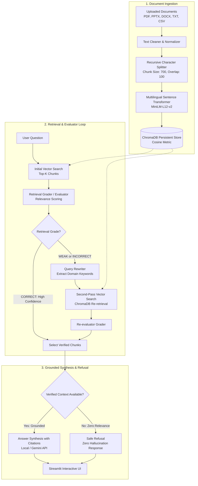

# Corrective Retrieval-Augmented Generation (CRAG) System 🛡️🤖

[](https://www.python.org/)
[](https://streamlit.io/)
[](https://www.trychroma.com/)
[](https://huggingface.co/sentence-transformers/paraphrase-multilingual-MiniLM-L12-v2)
[](#system-architecture)
[](#license)

An end-to-end, production-grade implementation of **Corrective Retrieval-Augmented Generation (CRAG)** designed to drastically improve the factual reliability of document-based question answering. 

Standard RAG architectures blindly feed retrieved passages into the generative model regardless of relevance, leading to hallucinations when context is weak. **CRAG** introduces a self-evaluating retrieval pipeline: it grades retrieved document chunks, detects irrelevant or marginal context, dynamically reformulates the query to re-retrieve when needed, and guarantees that answers are generated strictly from verified information.

---

## 🌟 Key Features

- **Document Ingestion Engine:** Multi-format parser supporting **PDF** (with automatic RapidOCR fallback for scanned slides), **PPTX**, **DOCX**, **TXT**, and **CSV** files.
- **Retrieval Evaluator (Document Grader):** Computes composite relevance scores (semantic embedding proximity + lexical term overlap) to classify retrieval into `CORRECT`, `WEAK`, or `INCORRECT`.
- **Adaptive Query Rewriting:** When context is evaluated as weak or irrelevant, the query rewriter disambiguates the prompt, eliminates conversational noise, and generates an optimized search query for a second-pass retrieval.
- **Strict Hallucination Prevention:** If no verified relevant context exists across both retrieval passes, the system refuses to generate ungrounded fabrications and explicitly reports that the documents lack the requested information.
- **Dual Inference Engine:** Supports instantaneous local semantic evaluation and generation, or direct integration with **Google Gemini API** for LLM-driven query rewriting and answer synthesis.
- **Interactive Streamlit Web Dashboard:** Real-time visualization of the CRAG decision tree, retrieval grades, query rewriting before-and-after diffs, and source citation tables.
- **Empirical Research Notebook & Benchmark Dataset:** Includes `crag_evaluation.ipynb` and `evaluation_dataset.csv` categorized by direct queries, ambiguous queries, and out-of-domain refusal cases.

---

## 🏗️ System Architecture



---

## 📁 Repository Structure

```text
Corrective_RAG_System/
│
├── app.py                          # Streamlit interactive web application & pipeline visualizer
├── crag_engine.py                  # Core CRAG engine (Ingestor, ChromaDB, Grader, Rewriter, LLM)
├── crag_evaluation.ipynb           # Research & empirical benchmarking Jupyter notebook
├── evaluation_dataset.csv          # Curated benchmark queries (Direct, Ambiguous, Out-of-Domain)
├── requirements.txt                # Production Python dependencies
├── .gitignore                      # Git exclusion rules for environments, cache, and vector DB
│
├── .streamlit/
│   └── config.toml                 # Custom UI theme configuration
│
└── sample_docs/                    # Ready-to-use academic reference documents
    ├── artificial_intelligence_overview.txt
    ├── cloud_computing_and_distributed_systems.txt
    └── renewable_energy_technologies.txt
```

---

## ⚙️ Technology Stack

| Component | Technology | Description |
| :--- | :--- | :--- |
| **Frontend UI** | [Streamlit](https://streamlit.io/) | Interactive dashboard with real-time pipeline telemetry |
| **Vector Database** | [ChromaDB](https://www.trychroma.com/) | Persistent HNSW vector indexing with cosine distance |
| **Embeddings** | `sentence-transformers` | `paraphrase-multilingual-MiniLM-L12-v2` |
| **Document Parsers** | `pypdf`, `python-docx`, `python-pptx` | Structural extraction with OCR fallback (`pypdfium2`, `RapidOCR`) |
| **Chunking** | `langchain-text-splitters` | Overlapping recursive character text splitting |
| **LLM Inference** | Gemini API / Local Synthesis | Dual-mode support for cloud LLM and offline environments |

---

## 🚀 Getting Started

### Prerequisites
- **Python 3.11** recommended
- Windows / Linux / macOS

---

### Installation & Setup

1. **Clone or navigate to the repository:**
   ```bash
   cd Corrective_RAG_System
   ```

2. **Create and activate a virtual environment:**
   * **Windows (PowerShell):**
     ```powershell
     py -3.11 -m venv .venv
     .\.venv\Scripts\Activate.ps1
     ```
   * **Linux / macOS:**
     ```bash
     python3.11 -m venv .venv
     source .venv/bin/activate
     ```

3. **Install dependencies:**
   ```bash
   python -m pip install --upgrade pip
   pip install -r requirements.txt
   ```

---

### Running the Application

1. **Launch the Streamlit App:**
   ```bash
   streamlit run app.py
   ```
2. **Access the application:** Open `http://localhost:8501` in your browser.
3. **Load Knowledge Base:**
   - In the sidebar, click **"Load Samples"** to automatically ingest the bundled academic documents, or drag-and-drop your own PDF/Word/PPT files.
4. **Test Corrective RAG:**
   - Click one of the quick test queries at the top (e.g. *CAP Theorem*, *Neural Nets*, or *Out-of-Domain*).
   - Watch the CRAG pipeline trace display the retrieval grade, query correction diff (if weak), and grounded answer.

---

## 📊 Benchmark Evaluation & Results

The included evaluation notebook (`crag_evaluation.ipynb`) benchmarks the system across three query categories:

$$\text{Relevance Score} = 0.70 \cdot \text{CosineSim}(q, d) + 0.30 \cdot \text{TermOverlap}(q, d)$$

| Category | Input Query Example | Expected Behavior | CRAG Outcome |
| :--- | :--- | :--- | :--- |
| **Direct In-Domain** | *"Explain the CAP theorem."* | High confidence match | `CORRECT` (Immediate Generation) |
| **Ambiguous In-Domain** | *"Tell me about those neuron things and how they learn."* | Initial retrieval weak | `WEAK` ➡️ Query Rewritten ➡️ `SUCCESS` |
| **Out-of-Domain** | *"Who won the FIFA World Cup in 1998?"* | Zero relevance | `INCORRECT` ➡️ Safe Refusal (No Hallucination) |

---

## 📖 Theoretical References

- Yan, S. Q., Gu, J. C., Zhu, Y., & Ling, Z. H. (2024). *Corrective Retrieval Augmented Generation*. arXiv preprint [arXiv:2401.15884](https://arxiv.org/abs/2401.15884).

---

## 🛡️ License

Developed for educational and academic research purposes.
